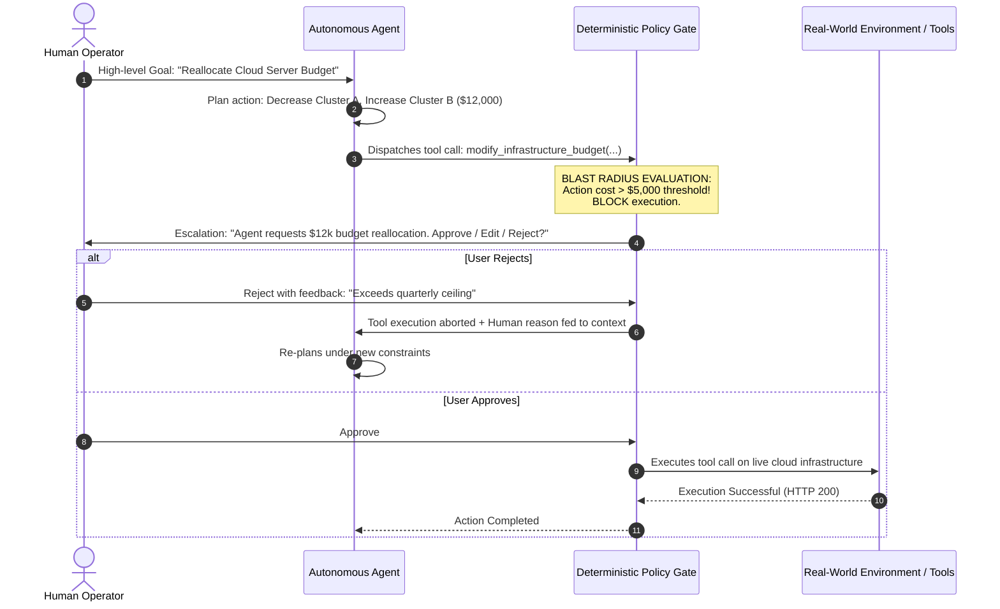

# Topic 7: Human-in-the-Loop (HITL) Systems in Agentic AI

---

## 1. ELI5 — What is Human-in-the-Loop (HITL)?

Imagine an autonomous AI assistant managing your daily communications. It monitors your inbox, extracts scheduling requests, coordinates calendar availability, and drafts responses.

Now imagine it drafts an email to your college principal or prospective employer regarding an official dispute. Should the agent dispatch the message instantly on its own, or should it pause and present the drafted email for your explicit review and sign-off?

A **Human-in-the-Loop (HITL)** system is an architectural design pattern in Artificial Intelligence where **human judgment, supervision, and intervention** are intentionally integrated into the autonomous execution pipeline.

```
+--------------------------------------------------------------------------+
|                       THE CORE HITL PARADIGM                             |
+--------------------------------------------------------------------------+
|      AI AGENTS                           HUMAN OPERATORS                 |
|  - High computational speed           - Contextual intuition & empathy   |
|  - Large-scale data ingestion         - Moral & ethical reasoning        |
|  - Multi-step routine planning        - Legal & financial accountability |
|                                                                          |
|       ===> SYNERGY: AI does the heavy lifting; Humans govern <===        |
+--------------------------------------------------------------------------+
```

> **Exam Definition:**  
> **Human-in-the-Loop (HITL)** is a cybernetic and software architectural framework in which autonomous AI agents operate under the active oversight of human experts, requiring explicit human validation, modification, or veto authorization before executing high-impact, consequential, or uncertain actions in real-world environments.

---

## 2. System Architecture: How HITL Works

A true HITL architecture cannot rely on the AI "voluntarily asking" the human for permission inside natural language text. The approval gate must be **deterministically enforced by the host operating infrastructure** or API gateway.



### The 4 Execution Phases:
1. **Goal Ingestion & Decomposition:** The agent breaks down the user request into concrete operational sub-steps.
2. **Policy Evaluation & Gate Interception:** Before any tool actuation executes, a deterministic runtime proxy inspects the payload against safety policies and risk tiers.
3. **Human Review Actions:**
   * **Approve:** Action executes unaltered.
   * **Edit / Steer:** Human modifies arguments (e.g., reduces dollar amount or rewrites sensitive email wording) before dispatch.
   * **Reject / Abort:** Action is cancelled; explanatory feedback is injected back into the agent's context window for replanning.
4. **Deterministic Actuation & Audit:** Only authorized actions reach the production environment, and all user interactions are logged to an immutable audit ledger.

---

## 3. Tripartite Taxonomy of Human Oversight

In modern AI systems engineering, human oversight is categorized into three distinct operational paradigms based on the degree of autonomy and timing of human intervention:

```
        AUTONOMY SPECTRUM
   Low Autonomy          Medium Autonomy         High Autonomy
   [--- HITL ---] =====> [--- HOTL ---] =====> [--- HOOTL ---]
   Synchronous Gate      Supervisory Monitor    Post-Hoc Audit
```

| Dimension | Human-in-the-Loop (HITL) | Human-on-the-Loop (HOTL) | Human-out-of-the-Loop (HOOTL) |
| :--- | :--- | :--- | :--- |
| **Human Role** | **Active Gatekeeper:** Must grant explicit approval before action occurs. | **Supervisory Monitor:** Observes autonomous operations in real-time; intervenes only upon anomaly. | **Post-Hoc Auditor:** No direct interaction during runtime; reviews logs and performance reports. |
| **Execution Latency** | High (gated by human cognitive response time). | Low to Medium (runs at machine speed until an abort is triggered). | Minimal (pure machine speed). |
| **Autonomy Level** | Semi-autonomous; bounded by validation checkpoints. | Highly autonomous; bounded by continuous anomaly detection. | Fully autonomous; bounded by predefined static policies. |
| **Failure Mode Response** | Fail-safe: Action is paused until human authorizes. | Fail-intervene: System executes until human hits emergency kill switch. | Fail-silent / Logged: System logs error or self-corrects without human notification. |
| **Representative Applications** | High-value wire transfers ($>\$10\text{k}$), oncology treatment plans, legal contract signing. | Drone swarm telemetry monitoring, autonomous warehouse robot fleets, algorithmic trade surveillance. | Routine email spam classification, static web page summarization, automated unit test generation. |

---

## 4. Key Architectural & System Design Principles

### A. Dynamic Approval Thresholds & Risk Tiers

Requiring human confirmation for every trivial agent action creates massive operational bottlenecks. Effective HITL architectures employ **tiered blast-radius policies**:

```
+-------------------------------------------------------------------------------+
|                       TIERED OVERSIGHT MATRIX                                 |
+-------+--------------------+------------------------+-------------------------+
| Tier  | Blast Radius       | Example Action         | Required Governance     |
+-------+--------------------+------------------------+-------------------------+
| Tier 1| Negligible / Zero  | Read document, cache query| HOOTL (Full Autonomy)  |
| Tier 2| Low (Reversible)   | Create draft, save file | HOOTL with Notify       |
| Tier 3| Moderate (Impactful)| Send email to client   | HOTL / Human on Loop    |
| Tier 4| High (Irreversible)| Drop database table, Wire $50k | HITL (Strict Gate)|
+-------+--------------------+------------------------+-------------------------+
```

### B. Uncertainty Estimation & Escalation Heuristics

An agent must be equipped with meta-cognitive self-assessment mechanisms to evaluate its own epistemic uncertainty.

$$\text{Escalation Triggered if: } \quad \text{Risk}(\text{Action}) > \tau_{\text{acceptable}}$$

Where expected risk is modeled as:

$$\text{Risk}(\text{Action}) = P(\text{Error} \mid \text{Uncertainty}) \times \text{Impact}(\text{Action})$$

* If an agent exhibits high confidence on a Tier 4 high-consequence action (e.g., dispensing a potent clinical pharmaceutical), **HITL is still mandatory** because $\text{Impact} \to \infty$.
* If an agent exhibits low confidence on a Tier 1 low-consequence action (e.g., classifying a movie review), the action may proceed or request non-blocking clarification.

### C. Continuous Feedback Loops (Active Learning & DPO)

Human interventions serve as high-quality supervised calibration data for continuous improvement:

```
[Agent Draft: Action A] ---> [Human Replaces with: Action B]
                                       |
                                       v
               [Trajectory Stored in Preference Dataset (D_pref)]
                                       |
                                       v
               [Direct Preference Optimization (DPO) / RLHF Fine-Tuning]
```

1. **Diff Extraction:** The system computes the mathematical difference between the agent’s proposed output and the human’s edited output.
2. **Preference Logging:** Pairs $\langle x, y_{\text{win}}, y_{\text{lose}} \rangle$ are stored in training repositories where $y_{\text{win}} = \text{Human Action}$ and $y_{\text{lose}} = \text{Agent Action}$.
3. **Prompt & Guardrail Refinement:** Few-shot exemplars and policy guardrail rules are updated to prevent recurrence of the identified flaw.

### D. Psychological Pitfalls in HITL: Bias & Fatigue

Designing effective HITL systems requires addressing human cognitive limitations:

1. **Automation Bias:**  
   The dangerous psychological tendency of human operators to uncritically trust automated systems, assuming the AI is infallible. When an AI presents an incorrect diagnosis or flawed trade, operators may "rubber-stamp" the recommendation without genuine evaluation.
2. **Approval Fatigue (Alert Fatigue):**  
   When a system floods the operator with hundreds of trivial approval modals daily, cognitive exhaustion sets in. The human stops scrutinizing and reflexively clicks **"Approve"** on everything, effectively destroying the security guarantee of the HITL layer.
3. **Mitigation Strategies:**
   * Enforce forced active interaction (e.g., requiring the reviewer to highlight key rationale or answer confirmation prompts rather than a simple 1-click button).
   * Intentionally insert calibration test samples (synthetic edge cases) into the review stream to measure operator alertness.
   * Dynamically tune threshold $\tau$ to keep approval volume within reasonable human cognitive capacity limits.

---

## 5. Comparative Trade-off Analysis

```
+-----------------------------------+-----------------------------------+
| ADVANTAGES OF HITL                | SYSTEM LIMITATIONS & TRADEOFFS    |
+-----------------------------------+-----------------------------------+
| 1. Severe Error Suppression:      | 1. Throughput Bottleneck:         |
|    Catches fatal hallucinations   |    Processing speed drops from    |
|    prior to irreversible mutation.|    milliseconds to human minutes. |
|                                   |                                   |
| 2. Moral & Legal Compliance:      | 2. Human Inconsistency:           |
|    Satisfies regulatory standards |    Human operators are prone to   |
|    (e.g., EU AI Act, HIPAA).      |    fatigue, bias, and distraction.|
|                                   |                                   |
| 3. Continuous Data Engine:        | 3. Substantial Operating Cost:    |
|    Generates golden preference    |    Requires maintaining trained,  |
|    trajectories for training.     |    licensed human domain experts. |
+-----------------------------------+-----------------------------------+
```

---

## 6. Quick Revision & Exam Review

```
+---------------------------------------------------------------------------------+
|                       HIGH-YIELD EXAM CHEAT SHEET                              |
+-----------------------------------+---------------------------------------------+
| Concept                           | Exam Definition                             |
+-----------------------------------+---------------------------------------------+
| Human-in-the-Loop (HITL)          | Synchronous human gatekeeping where action  |
|                                   | is blocked until explicit human approval.   |
+-----------------------------------+---------------------------------------------+
| Human-on-the-Loop (HOTL)          | Asynchronous supervisory monitoring where AI|
|                                   | acts autonomously but human can intervene.  |
+-----------------------------------+---------------------------------------------+
| Human-out-of-the-Loop (HOOTL)     | Completely autonomous execution without     |
|                                   | human intervention during task runtime.     |
+-----------------------------------+---------------------------------------------+
| Blast Radius                      | The maximum potential damage or scope of    |
|                                   | impact an action can cause if it fails.     |
+-----------------------------------+---------------------------------------------+
| Approval Fatigue                  | Diminished human vigilance caused by an     |
|                                   | overwhelming frequency of approval requests.|
+-----------------------------------+---------------------------------------------+
| Automation Bias                   | The tendency to uncritically accept machine |
|                                   | recommendations without due diligence.      |
+-----------------------------------+---------------------------------------------+
```

### High-Yield Exam Questions

1. **Why must HITL approval gates be implemented at the infrastructure/API gateway level rather than inside the LLM prompt?**  
   *Answer:* If the approval gate is merely written in the system prompt (e.g., *"Ask the user before calling the tool"*), an adversarial prompt injection or hallucination can cause the model to ignore this prompt instruction and directly emit the tool execution call. By embedding the gate into the deterministic API wrapper/proxy outside the model, the software runtime physically intercepts the network call and blocks execution until a cryptographically verified human token confirms it.

2. **Differentiate between HITL and HOTL with respect to control latency and system throughput.**  
   *Answer:* HITL introduces high control latency because the pipeline synchronously blocks until a human reviews and responds, resulting in low system throughput suitable for high-consequence, low-volume actions. HOTL operates asynchronously with near-zero latency, allowing the system to achieve high throughput at machine speed, while the human acts as an exception handler observing telemetry and intervening via emergency kill switches only when anomalous thresholds are breached.

---

## 7. Active Learning Quiz (Self-Check)

### Q1. What is the fundamental distinction between HITL and HOTL?
* **A.** HITL is used exclusively for natural language processing; HOTL is used for robotics.
* **B.** In HITL, the human must actively authorize decisions prior to execution; in HOTL, the AI acts autonomously while the human supervises and intervenes only when anomalies arise.
* **C.** In HITL, the human writes the code; in HOTL, the machine writes the code.
* **D.** HITL has zero latency; HOTL has high latency.

**Correct Answer:** **B**

---

### Q2. Why is asking an operator to confirm every single minor file read or database query considered bad engineering?
* **A.** It leads to prompt injection vulnerabilities.
* **B.** It causes Approval Fatigue, leading operators to blindly approve dangerous requests without reviewing them.
* **C.** It causes mathematical gradient degradation.
* **D.** It violates the Principle of Least Privilege.

**Correct Answer:** **B**

---

### Q3. Practical Architectural Problem:
**Scenario:** An autonomous banking agent detects a suspicious transfer of ₹2,00,000 to an offshore account.  
**Task:** Describe how a secure HITL workflow must handle this event, detailing the states of the system and why the agent cannot override the decision.

**Answer:**
1. **Detection & Risk Evaluation:** The agent plans a `transfer_funds(amount=200000, recipient="offshore_acc")` call. The deterministic transaction gateway intercepts the payload, recognizes that the amount exceeds the ₹50,000 autonomous threshold, and transitions the transaction state to `PENDING_HUMAN_AUTHORIZATION`.
2. **Synchronous Execution Block:** The agent's execution thread enters a paused state. The gateway renders an out-of-band notification to the bank fraud compliance officer containing the transaction details, risk justification, and customer transaction history.
3. **Tri-State Human Decision:**
   * **Approve:** Officer verifies legitimacy with the customer and clicks Approve $\to$ Gateway unlocks the transaction.
   * **Reject:** Officer confirms fraud $\to$ Gateway aborts the transfer, freezes the target account, and returns `FRAUD_BLOCKED` to the agent.
   * **Request Verification:** Officer triggers two-factor verification to the account owner.
4. **Deterministic Security Boundary:** The AI agent does not possess direct database write permissions or private banking keys; it only submits proposals to the gateway. Therefore, even if an attacker tricks the agent into issuing repeated transfer commands, the gateway physically denies every request lacking an authenticated cryptographic signature from the human compliance officer.
