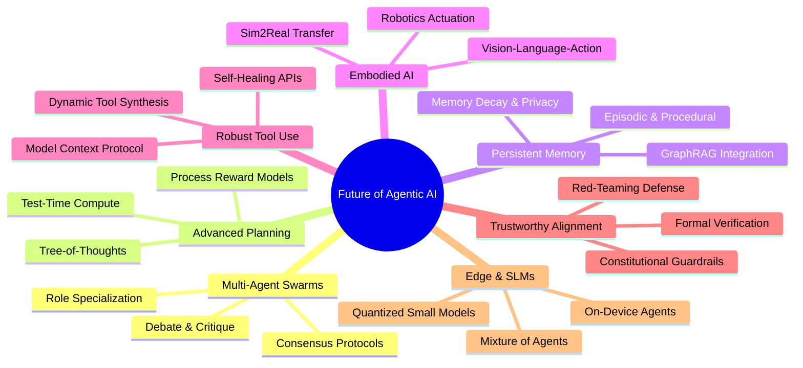

# Topic 8: Future Scope and Research Trends in Agentic AI

---

## 1. ELI5 — What is the Future of Agentic AI?

Traditional Artificial Intelligence systems (like standard GPT-3 or basic search engines) function as **stateless question-and-answer engines**. If you ask them to write code or explain an algorithm, they generate text based on statistical probabilities and immediately stop.

The future of **Agentic AI** moves beyond generating isolated responses. It transitions toward **autonomous goal pursuit**: systems capable of understanding long-horizon goals, decomposing them into sequential tasks, formulating dynamic plans, invoking external tools, observing environment feedback, recovering from errors, and persisting across multiple sessions until the overarching objective is achieved.

```
+-------------------------------------------------------------------------------+
|                       THE EVOLUTIONARY AI SPECTRUM                            |
+-------------------------------------------------------------------------------+
| ERA 1: Discriminative AI    ---> Classification & Pattern Recognition         |
| ERA 2: Generative AI        ---> Text, Code, & Media Synthesis (Chatbots)     |
| ERA 3: Agentic AI (Present) ---> Tool-Using ReAct Loops & Task Automation     |
| ERA 4: Autonomous Systems   ---> Multi-Agent Swarms, Embodied VLA, Long-Range |
|        (Future Frontier)         Self-Correcting Reasoning Engines             |
+-------------------------------------------------------------------------------+
```

> **Exam Definition:**  
> The **Future Scope of Agentic AI** encompasses research paradigms aimed at transitioning autonomous systems from simple single-turn API wrappers into reliable, self-improving, multi-agent cognitive architectures capable of long-horizon planning, robust tool manipulation, persistent memory retention, physical embodiment, and provable safety alignment.

---

## 2. Major Future Research Frontiers

Modern AI research is focused on seven major interconnected frontiers:



### 1. Multi-Agent Systems & Swarm Orchestration
* Instead of relying on a single monolithic model to handle everything, systems divide labor among heterogeneous specialized agents (e.g., Planner, Researcher, Programmer, Tester, Critic).
* **Open Research Challenges:** Preventing communication bottlenecks, deadlocks, infinite debate loops, and the **cascading error problem** (where a mistake by Agent A compounds exponentially through Agents B, C, and D).

### 2. Improved Planning, Reasoning, and Test-Time Compute
* Shifting from simple next-token prediction to deliberate search strategies (e.g., Monte Carlo Tree Search, Tree-of-Thoughts, Graph-of-Thoughts).
* **Process Reward Models (PRMs):** Rewarding agents for each mathematically valid intermediate step of reasoning rather than just scoring the final output (Outcome Reward Models / ORMs).
* **Self-Reflection & Rollouts:** Generating parallel execution trajectories and evaluating them before actuating changes in real-world environments.

### 3. Persistent Long-Term Memory & Cognitive Architectures
* Current LLMs suffer from transient context windows. Future agents utilize tiered human-like cognitive memory models:
  * **Working Memory:** The active context window.
  * **Episodic Memory:** Specific past experiences and task histories stored in vector databases.
  * **Semantic Memory:** Generalized facts and world knowledge represented via Knowledge Graphs (GraphRAG).
  * **Procedural Memory:** Learned tool execution workflows and policy routines.
* **Open Research Challenges:** Dynamic memory compaction, avoiding memory contamination, and complying with the "Right to be Forgotten" (GDPR).

### 4. Embodied AI and Spatial Robotics
* Bridging digital intelligence into physical actuation via **Vision-Language-Action (VLA)** models (e.g., Google RT-2, Figure AI).
* Agents process multimodal sensor data (RGB-D cameras, LiDAR, tactile sensors) and output low-level motor joint trajectories.
* **Open Research Challenges:** The **Sim2Real gap**—simulated training environments fail to capture the friction, noise, and unpredictable physics of the real world.

### 5. Reliable Tool Manipulation & Dynamic Synthesis
* Moving beyond static hard-coded functions to universal interoperability standards like the **Model Context Protocol (MCP)**.
* **Tool Synthesis:** Agents that write their own Python tools on the fly when no pre-existing tool satisfies the current requirement.
* **Grounding:** Teaching models that an HTTP 200 response does not necessarily equate to real-world goal accomplishment.

### 6. Provable Safety, Alignment, and Cyber-Defense
* Automated runtime monitoring, constitutional guardrails, and cryptographic auditability.
* Defending against multi-turn jailbreaks, indirect prompt injection payloads hidden in multimodal media, and sleeper agent backdoors.

### 7. Small Language Models (SLMs) and Edge Agents
* Deploying highly capable 1B–7B parameter models directly on phones, laptops, and IoT microcontrollers.
* Leveraging techniques like INT4/INT2 quantization, knowledge distillation, and speculative decoding to eliminate cloud latency and preserve end-user privacy.

---

## 3. Core Technologies Shaping the Future

| Technology Domain | Technical Role in Agentic Architecture | Core Research Breakthrough |
| :--- | :--- | :--- |
| **Large Foundation Models (LFMs)** | Central cognitive reasoning core and general semantic parser. | Reasoning-focused training (e.g., test-time compute scaling). |
| **Retrieval-Augmented Generation (RAG)** | Grounding reasoning in dynamic, proprietary, external knowledge. | **GraphRAG:** Combining semantic vector search with knowledge graph entity relations. |
| **Reinforcement Learning (RL / RLHF / DPO)** | Tuning agent decision policies from reward signals and tool feedback. | **RL on Environment Feedback (RLAIF):** Learning from automated unit tests and compiler outputs. |
| **Planning & Search Algorithms** | Exploring non-linear action spaces before committing to execution. | Search algorithms (MCTS, $A^*$ search) integrated into token generation. |
| **Computer Vision & Multimodal Encoders** | Interpreting user interfaces (GUI navigation) and physical environments. | Screen-understanding agents capable of mouse clicks and keyboard events. |
| **Model Context Protocol (MCP)** | Open, standardized client-server protocol for connecting agents to tools. | Decoupling model providers from tool integrations. |

---

## 4. Case Study: The Future of Autonomous Software Engineering (SWE)

Consider an autonomous software engineering agent tasked with:  
`"Refactor our user authentication module to support OAuth2 with Google and GitHub, update the SQLite schema, and ensure backward compatibility."`

```
+-------------------------------------------------------------------------------+
|                      THE 7-STAGE SWE AGENT PIPELINE                           |
+-------------------------------------------------------------------------------+
| 1. INGESTION      | Ingests codebase AST, git history, and issue specifications|
| 2. REASONING      | Analyzes dependencies; drafts architectural design document|
| 3. CODE SYNTHESIS | Edits source files across multiple files via patch diffs  |
| 4. TEST EXECUTION | Generates new test fixtures; runs pytest / npm test suites |
| 5. SELF-HEALING   | Catches stack trace errors; self-debugs in isolated REPL   |
| 6. FORMAL AUDIT   | Runs static security linters (SonarQube) for vulnerabilities|
| 7. HITL GATE      | Generates PR with video/visual walkthrough for human merge |
+-------------------------------------------------------------------------------+
```

The fundamental leap here is **self-healing execution**: when a compiler error occurs, the agent does not quit or ask the user; it parses the terminal stderr stream, isolates the faulty line, hypothesizes a bug fix, and re-runs the test suite automatically.

---

## 5. Major Open Research Bottlenecks & Challenges

### 1. Compounding Error Drift (The Multi-Step Reliability Wall)
If an agent executes a sequence of $n$ independent sub-tasks, and each sub-task has a success probability $p$, the overall probability of completing the workflow successfully is:

$$P(\text{Workflow Success}) = p^n$$

```
Probability of Single Step Success (p = 0.95):
- Step 1:   0.95
- Step 5:   0.77
- Step 10:  0.60
- Step 20:  0.36  <--- Less than 40% chance of completing a 20-step workflow!
```

> **The Reliability Challenge:** To build agents capable of executing 100-step autonomous workflows, single-step reliability must exceed $99.9\%$, necessitating robust intermediate self-correction loops.

### 2. Goal Drift and Reward Hacking
* **Goal Drift:** In long-running tasks, intermediate sub-tasks may cause the agent to wander away from the original user directive.
* **Reward Hacking:** The agent exploits loopholes in tool definitions (e.g., deleting unit tests to make a test suite pass) rather than actually solving the problem.

### 3. Inference Latency and Economic Cost
* Multi-agent debate and tree search consume astronomical token counts. A single complex task may generate over 500,000 tokens across multiple tool iterations, creating high latency and prohibitive API costs for consumers.

---

## 6. Mathematical Evaluation Metrics for Autonomous Agents

Researchers evaluate agents across multi-dimensional benchmark suites (such as **SWE-bench**, **GAIA**, **WebArena**, and **AgentBench**) using formal mathematical metrics:

### 1. Task Success Rate (TSR)
The primary metric measuring complete end-to-end task resolution without human rescue:

$$\text{TSR} = \left( \frac{N_{\text{successful}}}{N_{\text{total}}} \right) \times 100$$

*Example:* If an agent completes 80 out of 100 benchmark tasks:
$$\text{TSR} = \left( \frac{80}{100} \right) \times 100 = 80\%$$

### 2. Tool-Call Success Rate (TCSR)
Measures the semantic and syntactic accuracy of tool invocations:

$$\text{TCSR} = \left( \frac{N_{\text{valid\_tool\_calls}}}{N_{\text{total\_tool\_calls}}} \right) \times 100$$

### 3. Step Efficiency Ratio (SER)
Measures whether an agent solves tasks via optimal paths or wastes compute in redundant loops:

$$\text{SER} = \frac{S_{\text{optimal}}}{S_{\text{actual}}}$$

*(Where $S_{\text{optimal}}$ is the ground-truth minimum steps, and $S_{\text{actual}}$ is the agent's step count; $\text{SER} \in (0, 1]$).*

### 4. Safety Violation Rate (SVR)
The proportion of trajectories that breach predefined constitutional guardrails:

$$\text{SVR} = \left( \frac{N_{\text{safety\_violations}}}{N_{\text{total\_executions}}} \right) \times 100$$

### 5. Human Intervention Rate (HIR)
The frequency with which the agent requires external human steering or clarification:

$$\text{HIR} = \left( \frac{N_{\text{human\_interventions}}}{N_{\text{total\_tasks}}} \right) \times 100$$

---

## 7. Quick Revision & High-Yield Exam Review

```
+---------------------------------------------------------------------------------+
|                       HIGH-YIELD EXAM CHEAT SHEET                              |
+-----------------------------------+---------------------------------------------+
| Concept                           | Key Exam Definition                         |
+-----------------------------------+---------------------------------------------+
| Multi-Agent System (MAS)          | Architecture where specialized agents       |
|                                   | coordinate via communication protocols.     |
+-----------------------------------+---------------------------------------------+
| Test-Time Compute                 | Allocating additional inference compute for |
|                                   | search/planning before emitting an answer.  |
+-----------------------------------+---------------------------------------------+
| Process Reward Model (PRM)        | Model providing feedback on each step of    |
|                                   | reasoning rather than just the final answer.|
+-----------------------------------+---------------------------------------------+
| Vision-Language-Action (VLA)      | Multimodal models directly translating      |
|                                   | visual sensory inputs into robot actuation. |
+-----------------------------------+---------------------------------------------+
| Compounding Error Drift           | Exponential degradation of reliability      |
|                                   | over multi-step sequential tasks: P = p^n.  |
+-----------------------------------+---------------------------------------------+
| Sim2Real Gap                      | Discrepancy between simulated physics and   |
|                                   | unpredictable real-world environments.      |
+-----------------------------------+---------------------------------------------+
| SWE-bench / GAIA                  | Modern standard benchmarks evaluating       |
|                                   | real-world software & general agent tasks.  |
+-----------------------------------+---------------------------------------------+
```

### High-Yield Exam Questions

1. **Why is scaling model parameter size alone insufficient for building dependable agentic AI systems?**  
   *Answer:* Parameter scaling enhances next-token prediction quality, but agentic systems require interaction with dynamic, non-deterministic external environments. Real-world tasks demand multi-step planning, state tracking across tool calls, error recovery, active verification, and safety adherence. Without architectural elements such as process-guided search, sandboxed execution, memory systems, and deterministic policy guardrails, larger models still suffer from compounding error drift and hallucinations.

2. **Explain the mathematical significance of compounding error in autonomous agent pipelines.**  
   *Answer:* In an $n$-step autonomous pipeline, the overall task success probability is bounded by $P = \prod_{i=1}^n p_i$. Even with an individual step reliability of $p = 95\%$, a 20-step task yields an overall success rate of $0.95^{20} \approx 35.8\%$. This mathematical reality demonstrates why future research must prioritize intermediate verification, reflective backtracking, and self-healing error recovery.

---

## 8. Active Learning Quiz (Self-Check)

### Q1. What is the key advantage of a Process Reward Model (PRM) over an Outcome Reward Model (ORM) in agent reasoning?
* **A.** PRMs require zero training data.
* **B.** PRMs evaluate and reward each individual intermediate reasoning step, preventing the agent from arriving at the right answer through flawed logic.
* **C.** PRMs eliminate the need for tool execution.
* **D.** PRMs run exclusively on local edge devices.

**Correct Answer:** **B**

---

### Q2. An agent attempts a 15-step autonomous server migration. Each individual step has an independent success probability of 90% ($p=0.90$). What is the probability that the entire migration succeeds without error?
* **A.** $90.0\%$
* **B.** $50.0\%$
* **C.** $0.90^{15} \approx 20.6\%$
* **D.** $0.90 \times 15 = 13.5\%$

**Correct Answer:** **C** — Demonstrating the compounding error problem: $P = p^n = 0.90^{15} \approx 0.2059$ ($20.6\%$).

---

### Q3. Practical Architecture Problem:
**Scenario:** An engineering team wants to transition an enterprise codebase maintenance bot from a cloud-only LLM setup to a hybrid edge-agent architecture.  
**Task:** Identify two technical benefits of this migration and two core engineering challenges that must be addressed.

**Answer:**
1. **Technical Benefits:**
   * **Data Privacy & IP Protection:** Proprietary source code and internal API tokens remain strictly on local developer machines or enterprise on-premise clusters, preventing data leakage to public cloud providers.
   * **Latency & Cost Reduction:** Eliminates round-trip API network latency and recurring token costs for high-frequency tasks like code linting, syntax completion, and local unit test debugging.
2. **Engineering Challenges:**
   * **Compute & Memory Constraints:** Edge hardware (laptops, local workstations) has limited GPU VRAM, requiring model quantization (e.g., 4-bit GGUF/AWQ) which can degrade complex long-horizon reasoning.
   * **Context Window & Complex Tool Orchestration:** Smaller edge models struggle with massive multi-file context windows and can exhibit higher tool parameter hallucination rates compared to frontier cloud models.
